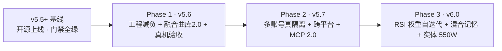

# MOSS 550W 下一阶段演进规划（`v5.6` → `v6.0`）

> 文档日期：2026-11-24 · 基线版本：`v5.5+`（公开仓库 [`langyan1022/moss-550w`](https://github.com/langyan1022/moss-550w) 初始基线 `3a975e5`）  
> 相关文档：[总览 README](../README.md) · [架构评估](./MOSS架构评估.md) · [技术演进路线](./MOSS技术演进路线.md) · [日常验收标准 v2](./MOSS日常验收标准.md) · [实体硬件与 HA 协议](./MOSS实体硬件与HomeAssistant对接协议.md)

---

## 一、现状复盘：基线盘点与真实短板

截至 `v5.5+` 首次开源推送，MOSS 550W 已具备完整的个人桌面与局域网伴侣核心链路（核心代码与运行时资产共 `594` 个跟踪文件 / `111.06 MB`，全量 4 阶段发布门禁 [`release_gate.py`](../prototype/release_gate.py) 通过，230 条黄金样本、双栈 HTTP/HTTPS、4 位 `CS/C` RBAC 门禁及融合曲库+Navidrome 均已上线）。但在直接迈向日常高强度使用与社区协作前，从代码结构、安全隔离、跨平台与真机验证四个维度排查出以下 **6 项真实短板**：

### 1. 代码体量集中与平铺测试耦合
- **核心模块偏重**：仅 4 个核心 Python 模块合计 **`9,014` 行**——[`assistant_brain.py`](../prototype/assistant_brain.py)（2,921 行 / 175.6 KB）、[`core.py`](../prototype/core.py)（2,539 行 / 142.0 KB）、[`serve.py`](../prototype/serve.py)（2,069 行 / 110.1 KB）、[`media_chat.py`](../prototype/media_chat.py)（1,485 行 / 90.6 KB）；前端 [`hud-popups.js`](../prototype/fui/public/js/hud-popups.js) 达 **2,294 行 / 102.6 KB**，[`app.js`](../prototype/fui/public/js/app.js) 1,462 行，[`voice.js`](../prototype/fui/public/js/voice.js) 1,431 行。
- **测试脚本分布**：[`prototype/`](../prototype) 根目录平铺有 **235 个** `verify_*.py/.mjs/.cjs` 脚本且存在大量跨文件导入（如 `verify_context_reply`、`verify_memory`、`verify_configured_mcp`），直接挪动目录会破坏既有引用，需要通过路由/模块渐进拆解 + CI 固定入口而非粗暴搬文件。

### 2. 多操作员 `CS/C` 仅隔离偏好、未隔离记忆与会话域
- 目前 `console_prefs` 已按 `user:<CODE>:<KEY>` 隔离 UI 个性化，但对话历史、[`soul_memory.py`](../prototype/soul_memory.py) / `memories`、便签、提醒与媒体播放记录仍共享同一份 SQLite 主库，尚不能真正隔离家庭成员或团队访客（`C` 级）对管理员（`CS`）私人事实与对话的检索。

### 3. 实机物理生态的长程验证仍存在留白
- 依据 [`MOSS日常验收标准.md`](./MOSS日常验收标准.md)，离线与静音 Edge 门禁已全绿，但以下 4 类真实物理场景仍待完整长测：
  1. [`run_room_acoustic_acceptance.py`](../prototype/run_room_acoustic_acceptance.py) 的 **30 分钟实体扬声器 + 实体麦克风**远场回声/打断压测（对应标准中未测必扣的 4 分）；
  2. 移动硬盘（如 `G:`）反复休眠/热拔插后 `Navidrome` 自动扫描同步与公网无缝兜底/切回；
  3. 实体 UVC 摄像头开启手势识别的连续运行稳定性与温控/内存曲线；
  4. Windows 睡眠/锁屏跨越定时任务（`assistant_timers.py`）到期后的系统补唤醒行为。

### 4. 单平台与外置服务路径耦合
- [`online_music.py`](../prototype/online_music.py) 强制依赖 Windows `win32crypt` DPAPI 加密，在 Linux / macOS / Docker 容器克隆后无法保存线上曲库凭据；[`iot_bridge.py`](../prototype/iot_bridge.py) 的 Home Assistant Token 也尚未接入同等级本地加密。
- [`voice/asr_engine.py`](../prototype/voice/asr_engine.py) 等语音模块默认路径绑定外部 `VOICESTUDIO_ROOT`（`E:\VoiceStudio`），尚缺面向开源用户的标准 OpenAI 兼容 `/v1/audio/*` HTTP 适配器与 Docker 部署模板。

### 5. 融合曲库浏览与移动端伴侣能力不对等
- 私有 Navidrome 目前已接通单曲检索、转码流与 Subsonic 歌词，但还缺**歌单（Playlists）/ 专辑（Albums）浏览、安全封面代理与播放计数 `scrobble` 回写**。
- 手机伴侣页 [`mobile.html`](../prototype/fui/public/mobile.html) 已支持对话、FFT 频谱与授权门禁，但缺少在线曲库队列切歌、实时 LRC 歌词和入眠定时快捷控制。

### 6. 高阶智能模块仍处半闭环
- [`rsi_engine.py`](../prototype/rsi_engine.py) 已输出 `data/rsi-dpo-episodes.jsonl`，但尚未接离线 QLoRA/DPO 微调与 230 条黄金集 A/B 对比验收。
- [`mcp_configured.py`](../prototype/mcp_configured.py) 仅支持本地 `stdio`，暂不支持远程 Streamable HTTP / SSE MCP 与按问题按需注入少量 Tool Schema。
- 记忆检索按 [`MOSS架构评估.md`](./MOSS架构评估.md#L105-L114) 的对照证据，仍需把「精确编号走词项/FTS5 + 中文同义走独立向量模型 + 严格空拒门限」真正合并上线。

---

## 二、分阶段演进路线（`v5.6` → `v5.7` → `v6.0`）

### Phase 1 · `v5.6`：工程减负、Navidrome 2.0 与真机闭环（1–2 周）

| 优先级 | 事项 | 核心交付物与技术要点 | 验收标准 |
| --- | --- | --- | --- |
| **P0** | 跨平台加密存储底座 | 抽出统一 `secret_store.py`：Windows 沿用 DPAPI 保持向后兼容，非 Windows 自动降级 `cryptography.fernet` + `0600` 本机密钥；同步接入 [`online_music.py`](../prototype/online_music.py) 与 [`iot_bridge.py`](../prototype/iot_bridge.py)（含旧明文 HA Token 自动迁移加密） | Windows 与纯 Python 环境加解密测试全过；现有 `online-music.json` 零重录无缝读取 |
| **P0** | Navidrome 2.0 与移动端补齐 | 新增 Navidrome 歌单/专辑浏览、`/api/online-music/browse`、SSRF 防护封面代理 `/api/online-music/cover/{id}`、开播回写 `/api/online-music/scrobble`；桌面 Media HUD 与 [`mobile.html`](../prototype/fui/public/mobile.html) 支持歌单浏览、封面、队列切歌与同步 LRC 歌词/入眠定时 | `verify_online_music.py`、`fui_lint`（0/0/0）与 Edge UI 队列点击自播回归全过 |
| **P1** | GitHub Actions CI 与路由渐进拆分 | 新增 `.github/workflows/ci.yml` 自动运行 `release_gate.py --stages static,unit`；从 [`serve.py`](../prototype/serve.py) 与 [`hud-popups.js`](../prototype/fui/public/js/hud-popups.js) 渐进拆出高内聚路由/视图子模块，并登记进 [`release_gate.py`](../prototype/release_gate.py) 契约扫描范围 | CI 全绿；4 阶段门禁 0 报错 |
| **P1** | 真机长程声学与移动硬盘实测 | 运行 [`run_room_acoustic_acceptance.py`](../prototype/run_room_acoustic_acceptance.py) 30 分钟实体音箱/麦验收；记录 `G:` 盘拔出兜底与复插回切时间线、手机 HTTPS 实麦长聊与实体摄像头热稳定性 | 更新 [`MOSS日常验收标准.md`](./MOSS日常验收标准.md) 实机评分并归档耗时读数 |

### Phase 2 · `v5.7`：多用户数据域隔离、开放语音与 MCP 2.0（2–4 周）

| 优先级 | 事项 | 核心交付物与技术要点 | 验收标准 |
| --- | --- | --- | --- |
| **P0** | 操作员级数据域隔离 | 将 `operator_code`（`CS` / 各个 `C` 用户）写入对话、记忆、便签、提醒与媒体账本表主键/过滤条件；C 级用户默认进入隔离工作区与公共媒体域，严禁跨用户检索 CS 私人记忆 | 双 Cookie（`CS` vs `C1` vs `C2`）跨读/跨删 HTTP 回归全部返回 `403` 或零泄漏 |
| **P1** | 语音适配器与容器化友好 | 为 ASR/TTS 新增标准 OpenAI `/v1/audio/speech` & `/v1/audio/transcriptions` 可选后端配置，支持无 `VOICESTUDIO_ROOT` 的纯 Docker / Linux 运行；提供 `Dockerfile` 与最小环境变量清单 | Linux/容器下无报错启动对话、曲库、记忆与 Web FUI |
| **P1** | MCP 2.0（HTTP/SSE + 动态装配） | [`mcp_configured.py`](../prototype/mcp_configured.py) 增加 Streamable HTTP/SSE 传输，先做工具描述本地匹配再向本机 4K 模型按轮仅注入 Top-K 工具 Schema，并保留副作用工具二级确认门 | 慢 MCP 取消、跨协议工具调用及小模型首字耗时零明显退化 |

### Phase 3 · `v6.0`：自进化微调闭环与实体 550W 落地（长期）

| 优先级 | 事项 | 核心交付物与技术要点 | 验收标准 |
| --- | --- | --- | --- |
| **P1** | 混合记忆精确+语义双路与空拒校准 | 落地精确代号（SQLite FTS5/BM25）+ 中文改写（本地 Embedding）加权融合，加入置信度空拒阈值与遗忘彻底清除审计（覆盖快照与向量表） | 冻结题库上编号 `8/8`、中文改写 `>=7/8` 且无关题误带降为 `0/3` |
| **P2** | RSI → 本机 QLoRA/DPO 实测验证 | 使用 `data/rsi-dpo-episodes.jsonl` 对 Qwen3.5-4B 做离线 QLoRA/DPO 对照试验，与基线+Playbook 注入在 230 条黄金基准上同台比拼 | 工具准确率、口语规则与零幻觉率均显著优于纯注入才合并上线 |
| **P2** | 实体 550W（`moss-hw-v1`）硬件与 HA 实机 | 新增开源 `hardware/` 固件参考（ESP32-S3 / 树莓派消费 `/api/hardware/moss/stream` 驱动 WS2812B 红眼、双轴云台舵机、H50 SPI 小屏，并上报毫米波存在检测）；接真 Home Assistant 验证 `live` 回读确认 | 实体按键唤醒、舵机随声追踪及真实灯控/空调回读状态一致 |

---

## 三、推进原则（防回归铁律）

1. **所有结构拆解以 [`release_gate.py`](../prototype/release_gate.py) 全绿为前置门禁**：每次模块拆分或新增端点必须同步通过 Stage 1（跨模块 JS 契约 / i18n 中英零差额 / `fui_lint` 0 错 / 3D 模型清单校验）与对应单测。
2. **不擅自移动被交叉引用的历史 `verify_*` 脚本**：凡存在互导依赖的脚本在统一抽离公共夹具前保持原导入路径可见，避免破坏既有回归资产。
3. **坚持先隔离跑通、再切线上**：任何实机长测与模型试验先在独立端口 + 临时目录验证，绝不污染日常会话库与真实密钥目录。
