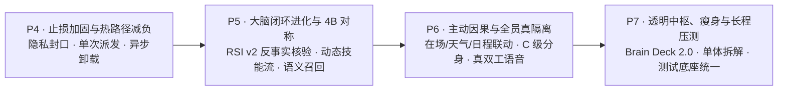

# MOSS 550W 下一阶段深度演进规划（`v6.1` · P4–P7）

> 文档日期：2026-11-24 · 基线版本：`v6.0 P0–P3` 完成态（发布门禁 `release-gate-p0-p3-final-clean-20261124-135153` 全绿，`163.65s`）  
> 核心原则：**不求快，求好用——优先封堵已定位的真实漏洞与隔离死角，再按可控里程碑推进大脑真闭环、因果主动智能与全景可观测性。**  
> 相关文档：[总览 README](../README.md) · [技术演进路线](./MOSS技术演进路线.md) · [上一阶段规划 v5.6–v6.0](./MOSS下一阶段演进规划_v5.6-v6.0.md) · [日常验收标准 v2](./MOSS日常验收标准.md) · [架构评估](./MOSS架构评估.md)

---

## 一、基线盘点：P0–P3 已沉淀能力与当前骨架指标

经过 `P0–P3` 四阶段改造，MOSS 550W 已从早期的单文件原型跨越到模块化、有硬门禁兜底的本地优先 AI 伴侣系统：

1. **已完成底座**：
   - **大脑模块化与并发隔离**：[`assistant_brain.py`](../prototype/assistant_brain.py) 拆分出 [`brain/`](../prototype/brain/__init__.py)（路由、注册表、提示词、处理器、气象流、引擎、`math_date_tools`、`web_tools`）；`pydantic_ai` 与草稿审批剥离进 [`draft_runtime.py`](../prototype/draft_runtime.py)；[`core.py`](../prototype/core.py) 引入按操作员区分的 `_RunSlot` 并发槽（`_slot` / `_slot_for_chat` / `_slot_for_turn`），建立笔记/日历与 SAG 同步入口（`sync_note_sag` / `sync_calendar_sag`）。
   - **存储并发、跨表遗忘与传输安全**：`session.sqlite3` 启用 `WAL + synchronous=NORMAL + busy_timeout=5000 + foreign_keys=ON`；实现 `cascade_forget_memory` 与敏感信息脱敏（`redact_sensitive_text`）；落地按操作员队列唤醒（`subscribers_by_owner`）与 `event: brain-alert` 主动告警通道；融合曲库凭据与 HA 令牌接入跨平台 DPAPI/Fernet 加密（[`secret_store.py`](../prototype/secret_store.py)）。
   - **内核韧性与前端解压**：[`holo_kernel.py`](../prototype/holo_kernel.py) 实现全错误码静默故障转移与 `local_wake_fn` 唤醒重试；手势推理 offload 至 [`gesture-worker.js`](../prototype/fui/public/js/gesture-worker.js) 并支持模拟/异常场景无缝切回主线程（[`gestures.js`](../prototype/fui/public/js/gestures.js)）；`hud-popups.js` 拆出工具/图像文档/天气宿主视图；[`testkit/__init__.py`](../prototype/testkit/__init__.py) 规避 Windows 保留端口 `18222..18321`。
2. **最新验收基准**：
   - `release_gate.py --stages static,unit,audio,ui` 全绿（90 份核心 Python 编译、35 份 JS 语法、`i18n` `802/802`、`16` 组控制器/`497` 个 DOM ID 零断链、`verify_daily_golden_200` `260/260`、`verify_brain_cognitive_suite` `108/108` 含 `G8_p0_p3_arch` `8/8`、RTX 3070 Ti `warm` 语音 `1.531s` / 起音 `0.09s`、8 枚徽章像素校验及热插拔恢复）。
   - 真实阿里云百炼 `verify_brain_v6_gauntlet.py` **`16/16`** 全过；`verify_calendar_mutations.py`、`verify_reminder_queries.py` 与 `verify_memory_browser_local.py` 全数通过。
3. **当前体量分布（待继续治重）**：
   - **后端头部文件**：[`core.py`](../prototype/core.py)（`2,909` 行）、[`serve.py`](../prototype/serve.py)（`1,643` 行）、[`media_chat.py`](../prototype/media_chat.py)（`1,485` 行）、[`online_music.py`](../prototype/online_music.py)（`1,319` 行）。
   - **前端头部文件**：`hud-popups.js`（`1,817` 行）、`app.js`（`1,462` 行）、`voice.js`（`1,431` 行）、`i18n.js`（`1,231` 行）、`dialogue.js`（`1,115` 行）、`modals.js`（`1,098` 行）、`telemetry.js`（`1,069` 行）、`mobile.html`（`1,000` 行）。
   - **测试脚本分布**：`prototype/` 根目录平铺 `224` 个 `verify_*.py` 与 `7` 个 `verify_*.mjs`，`runs/` 下累积约 `729` 个运行产物目录。

---

## 二、深度源码排查：制约“真正好用”的现存障碍与结构上限

本轮基于当前最新源码逐行审计，确认以下 **两类现实问题**：一类是可直接引发静默失效或越权的**隐蔽代码缺陷**；另一类是限制系统智能度与稳定性的**四大架构天花板**。

### A. 现存 6 项隐蔽缺陷（须在 P4 优先止损）

| 编号 | 缺陷现象与实际后果 | 源码实证定位 |
| --- | --- | --- |
| **B1** | **`_notify()` 双重派发放大，削弱按操作员隔离推流收益**：每次 `150ms` token 刷新或单操作员状态更新都会触发两次 `RuntimeLog.capture()` 重复查库，并同时唤醒**全部**在线操作员 SSE 队列 | `core.py:1049-1055` 同时调用 `on_owner_change` 与 `on_change`；`serve.py:463-467` 中 `changed()` 又调用 `changed_owner(None)` |
| **B2** | **日历 → SAG 同步静默失败，夜间做梦看不见日程**：创建/修改日程从未写入 `sag_events`，导致跨项目排期冲突检查存在盲区 | `core.py:358-365` 调用 `self.sag.upsert_event(..., time_label=...)`，而 `sag_knowledge.py:277-286` 无 `time_label` 参数，抛出 `TypeError` 后被 `except Exception: pass` 吞没 |
| **B3** | **C 级操作员高危隐私泄漏与 RBAC 漏网**：① C 级访客与免记忆会话可被动召回管理员截图识图与附件文本；② C 级可读写管理员音乐偏好并在控制台/日志流偷窥宿主机 OLED/SAG/RSI/HA 实时信息；③ 自检永远把真实 HA 报告为 `dry_run` | ① `sag_knowledge.py:566-570` `private_srcs` 漏列 `"vision"` 与 `"attach"`；② `brain/registry.py:452` 与 `brain/handlers.py:976-1006` 无 `host_only=True`，`serve.py:539-545` 漏拦 `GET /api/music/prefs`、`/api/skills`、`/api/hardware/moss/stream`、`/api/runtime-log/stream`、`GET /api/online-music/browse`；③ `core.py:2735-2736` 检查不存在的 `iot_snap.get("ha_live")`，`brain_iot_routes.py:90` 未从 `iot_snap["config"]` 取 `ha_enabled` |
| **B4** | **鉴权中间件启用条件与停机 SSE 悬挂风险**：非 FUI 入口启动时不挂 `moss_auth_check`；权限路径靠中间件两份硬编码列表维护，极易随新路由漂移；停机不主动唤醒 SSE 等待队列 | `serve.py:1433-1437`（仅 `fui_public is not None` 注册）、`serve.py:534-572`（12 GET + 22/9 POST 硬编码）、`serve.py:430-437, 1573`（依赖 1s 强杀） |
| **B5** | **前端重复 SSE、闭窗轮询与失效重挂载**：每个控制台标签页建立两条 `/api/runtime-log/stream` 连接接收双份诊断帧；大脑弹窗未打开时仍每 20s 轮询全量概览；3D 舞台重试按钮无法重建已转移 `OffscreenCanvas` 的 Worker；手势启动忙保护死代码 | `api.js:452` + `moss-view.source.js:109`；`brain-deck.js:782-786`；`stage.js:210-213` + `moss-view.source.js:37-39`；`gestures.js:610-634`；`voice.js:479` 与 `mobile.html:873` 仍用已废弃 `createScriptProcessor` |
| **B6** | **事件循环阻塞与重复单例/导入环**：休眠整理、SAG 全量向量计算、文件哨兵（每 `0.45s` 读 64KB）、歌词读库直接在异步事件循环上同步阻塞；`DeviceStatusCache`、`INSTRUCTIONS`、`console_prefs` DDL、`escapeHtml` 双重定义；`local_overview.py` 环状导入 `assistant_brain` 且重复解析提醒/日历 | `sleep_consolidator.py:331-334`、`sag_knowledge.py:395-552`、`background_jobs.py:351-398`、`runtime_log.py:314-373`、`online_music_routes.py:43`；`serve.py:226` vs `brain/handlers.py:48`；`local_overview.py:103-106, 282` |

### B. 限制智能化与工程上限的四大结构性天花板

1. **大脑进化天花板：RSI“功劳膨胀 + 淘汰失灵”与 `run_custom_skill` 工具冻结死结**
   - `brain/engine.py:448-451` 只要将 `always_bias=0.35`（`rsi_engine.py:491`）的 `tone`/`safety` 规则注入上下文，下一轮若用户未触发纠错（`core.py:2799-2808`），`RSIEngine.record_credit(corrected=False)` 即无条件给**所有**被注入规则累加 `helped_count += 1`。坏规则只要夹杂 3 轮普通闲聊即永远无法达到 `failed_count > helped_count` 淘汰门限（`rsi_engine.py:455-456`），甚至凭 2 轮无报错直接晋升为永久 `soul_beliefs`（`soul_memory.py:344-371`）。
   - `Moss.run_rsi_cycle()`（`core.py:2863-2880`）仅扫宿主单一 `self.chat_id` 且从未被 `serve.py` 休眠任务自动调度；`rsi-dpo-episodes.jsonl` 记录的往往是纠错后的元回复（如“好的，记下了”）而非针对原请求的正向修正样本；“影子验证”（`rsi_engine.py:708-729`）仅测词法召回而不做反事实响应 A/B 对比。
   - **技能死结**：`brain/router.py:202-203` 触发 `run_custom_skill` 时未把技能涉及的工具注入 `Brain._tool_names`，导致模型按技能提示调用 `consolidate_world_model`、`ha_control_device`、`query_calendar` 等工具时被 `holojarvis_runtime/brain.py:67-69` 当场拦截为“不在本轮可用列表中”。同时 `_h_run_custom_skill` 未递增 `use_count`。
2. **本机 Qwen3.5-4B（4096 ctx）上下文破损与路由不对称**
   - `brain/engine.py:510-514` 对 `instructions[:420]` 直接进行字符切片，极易从记忆 JSON 数组中间劈断破坏结构；`brain/router.py:271-274` 对本机 4B 初始仅给 `[CLOCK, WEATHER]` 且硬编码 `wide=False`，复合请求无法扩展核心工具；而 `holojarvis_runtime/brain.py:124` 仍沿用 `7200` 字符工具摘要总量预算，多工具轮易触及 `--ctx-size 4096` 上限且本机无云端降级链。
   - 复合句拦截（`core.py:2010-2018` `named` 直达播歌未检查 `compound_request`、`brain/router.py:112-115` 缺常见连词）及非媒体工具轮绕过 `filter_unverified_media_reply`（`brain/engine.py:570-571`）仍会造成局部误判。
3. **主动智能“孤岛化”与多用户分身不完整**
   - `CurrentWeatherCache` 从未进入 `ProactivePulseEngine`；`iot.hw_sensors`（`person_present`、`ambient_lux`、`chassis_temp_c`）只响应物理 `wake` 按键，无人时仍照发通知；`recurring_tasks` 的 `action_kind="prompt"` 在 `serve.py:385-394` 仅弹静态通知文本，未实际执行 Agent 指令；`music_prefs` 未过滤本地/NAS 曲库（`media_chat.py`）。
   - `sag_events`、`soul_profile`、`soul_beliefs`、`rsi_lessons`、`world_model_snapshots`、`recurring_tasks` 仍整体锁定宿主 `"MOSS"`，C 级操作员拥有独立对话与精确记忆后，仍缺少独立的个人知识图谱、习惯演化与世界模型。
4. **可观测性黑盒与历史测试债**
   - 后端已有丰富状态却未到达 [`brain-deck.js`](../prototype/fui/public/js/brain-deck.js) 与聊天气泡：无 `include_usage` Token 计量、无标准轮次 `reply_ms`、气泡隐藏工具参数/错误、中枢忽略 `self_diagnostics.brain.provider_health`（EWMA 延迟/冷却/连败）、`rsi_cycles`/Soul 轮次溯源、`iot_action_log`（`dry_run` vs `live`）、硬件传感器、例行任务与哨兵界面，且已有 SSE `/api/hardware/moss/stream` 无人订阅。
   - 根目录下 `verify_memory.py` 等 `22` 个旧脚本仍依赖 `static/conversation.html` 的 `data-testid`（且因 [`browser_lab.py`](../prototype/browser_lab.py) 默认指向外部未拉起的 `18332` 模型端口及不设 `MOSS_ISOLATED_FUI=1` 而无法孤立运行）、`53` 个脚本等待 `.connection.online`、`19` 个脚本与 `release_gate.py:618` 仍裸绑端口；同时缺乏**本机 4B 实机工具回归**、**多操作员并发 SSE 回归**及 **>50 轮摘要压缩 / >2,000 条 SAG / RSI 淘汰边界长程压测**。

---

## 三、P4–P7 渐进演进路线

---

### Phase P4：隐私封口、隐蔽故障清零与事件循环减负

**目标**：在不改外部交互契约的前提下，消除前述全部 6 项现存缺陷（B1–B6），确保隔离绝对严谨、后台轮询不再堵死异步事件循环。

| 子项 | 技术方案与核心改动点 | 验收门槛 |
| --- | --- | --- |
| **P4.1 通知与日历修管** | 1. 保留 `moss.on_change` 兼容旧单测，在 `core.py:1049-1055` 优先调用 `on_owner_change`（仅当 `on_owner_change` 未绑定时才回退 `on_change`），并在 `serve.py:463-467` 仅注册 `on_owner_change`：`owner_code` 有值时仅唤醒对应操作员与运行时订阅者。 2. 对齐 `Moss.sync_calendar_sag()` 与 `SAGKnowledgeBase.upsert_event()` 参数并保留结构化时间槽位元数据，记录失败日志而非静默 `pass`。 | 单操作员发消息时日志仅捕获 1 次、不唤醒无关操作员队列；新建/改期/取消日程实时反映进 `sag_events` |
| **P4.2 零死角 RBAC 与自检修正** | 1. `sag_knowledge.auto_recall()` `private_srcs` 补全 `"vision"`、`"attach"`，并收敛 `"doc"`/`"research_job"` 私有来源策略。 2. 为音乐偏好工具加 `host_only=True`，`serve.py` 中间件改由路由声明式权限元数据驱动，补齐 `/api/music/prefs`、`/api/skills`、`/api/hardware/moss/stream`、`/api/runtime-log/stream`、`GET /api/online-music/browse` 的 C 级拦截，并在非 FUI 模式同样注册 `moss_auth_check`。 3. 修复 `core.py`（`ha_live`→`config.ha_mode=='live' and ha_enabled`）与 `brain_iot_routes.py` 状态口径。 | 新增 C 级操作员尝试检索宿主机截图识图/附件/音乐偏好/技能/实时日志的负例测试，全部拦截（`403` 或零召回） |
| **P4.3 异步 I/O 卸载与连接复用** | 1. 严守 `Moss.db` 主写连接及 `:memory:` 测试库的线程亲和约束：仅将文件 I/O、正则扫描、NumPy 矩阵计算（缓存嵌入副本上执行，命中计分写回仍走事件循环）及实体盘库（确认非 `:memory:` 时才开只读 WAL 连接）经 `asyncio.to_thread` 异步卸载。 2. 全局复用 app 级共享 `aiohttp.ClientSession` 替代逐次创建（无 app 上下文时兼容回退）。 3. 合并重复 `DeviceStatusCache`、`INSTRUCTIONS`、`console_prefs` DDL 及前端 `escapeHtml`；消除 `local_overview.py` 环状导入与二次日历/提醒解析；停机 `stopped.set()` 显式广播唤醒全部 SSE 事件集。 | 高并发及大库场景 `loop` 阻塞毛刺明显下降；停机响应 `<1s` 无强杀报错；`:memory:` 单测 100% 兼容 |
| **P4.4 前端推送去重与安全修复** | 1. 桌面控制台共用单一 `/api/runtime-log/stream` 连接（通过内部事件总线分发至 `moss-view` 与底部运行日志栏）。 2. `brain-deck.js` 仅在 `#dlg-brain` 打开期间启动刷新，并改为优先监听 SSE 增量。 3. 修复 `gestures.js` 启动忙保护死代码，补全 `serve.py` 启动日志动态端口注入替代硬编码 `:18221`。 | 打开单标签页时 `/api/runtime-log/stream` 仅存 1 条 SSE；关闭大脑弹窗零后台轮询请求 |

---

### Phase P5：大脑可验证闭环（RSI v2）、动态技能与 4B 本地对称

**目标**：让自我学习从“只会攒文字经验”升级为“经过行为核验与反事实对照才生效”，解除 `run_custom_skill` 死结并让本机 4B 具备均衡的工具执行精度。

| 子项 | 技术方案与核心改动点 | 验收门槛 |
| --- | --- | --- |
| **P5.1 RSI v2 闭环归因与反事实核验** | 1. **精细化归因**：记录每条规则的“实际被引用/场景命中证据”，停止仅因下一轮没挨骂就无脑加分；扩展纠错回溯窗口至近 2–3 轮对话。 2. **周期挖掘与 DPO 重采**：`proactive_heartbeat_loop` 空闲期自动按活跃会话调度 `run_rsi_cycle()`；针对纠错样本设预算上限（每次巡检最多 `2–3` 条且避开本地语音显存占用）生成可用 `(prompt, chosen, rejected)` 进 `rsi-dpo-episodes.jsonl`。 3. **晋升硬门槛**：仅在反事实或多次真实关联命中验证通过后才晋升 `soul_beliefs`。 | 注入错误风格规则后夹杂 3 轮普通闲聊再触发 2 次纠错时，规则必须被自动降级淘汰，禁止误升灵魂信念 |
| **P5.2 语义工具召回与可执行技能图** | 1. 利用 `embed_text_local()` 计算工具簇语义得分，与现有高频正则路由器混合打分，精准覆盖“屋里太暗了 / 下周出差上海”等隐式意图。 2. `custom_skills` 扩展结构化字段 `required_tools` 与可选 `workflow_steps`；`run_custom_skill` 严格受限于技能已声明且通过安全白名单（遵守 `host_only`、禁止隐式提权至 `shell`/`shutdown`）的工具集，于当轮安全解锁进 `Brain` 调度器并计数 `use_count`。 3. 开放从高频成功 `turns.tool_trace` 一键固化结构化多步宏。 | 内置与自定义多工具技能（跨天气/日程/记忆/HA）通过 `run_custom_skill` 一次性跑通无“不在可用列表中”报错；未声明敏感工具严禁动态提权 |
| **P5.3 4B 上下文结构化装配与复合句修复** | 1. `brain/engine.py` 淘汰 `[:420]` 字符腰斩，按记忆条目重要度与得分执行**整条 JSON 项裁剪**；`holojarvis_runtime/brain.py` 针对 `provider_id == "local"` 计算剩余 Token 预算控制工具回报尺寸。 2. 本机 4B 按轮语义动态扩充工具包（在上下文许可下解除 `wide=False` 死锁），并保留精简版工具消歧规则。 3. 修复 `core.py` `named` 播歌与 Tier-1 解析对常见连词（“然后/再查/顺带”）复合句的第二意图吞并。 | 上线**本机 Qwen3.5-4B 实机工具与复合意图基准集**（含长历史 + 多工具 + 记忆混合），验证无截断崩溃且工具召回达标 |

---

### Phase P6：跨信号因果主动智能、C 级个人世界模型与真双工交互

**目标**：打通“感知 → 推理 → 动作/交互”闭环，让物理桌面、移动分身与多成员共享体验真正协同好用。

| 子项 | 技术方案与核心改动点 | 验收门槛 |
| --- | --- | --- |
| **P6.1 主动因果推理与例行任务真执行** | 1. 把实时天气缓存、物理传感器（`person_present` 未接入硬件时默认视作 `True` 以免静默漏报 / 光照 / 温度）、日历 SAG 与日志哨兵接入 `ProactivePulseEngine` 规则引擎（支持在场延后与到座补报、行程+降雨提醒、异常分级同步驱动 550W 灯效/H50 帧、疲惫抑制动态调长冷却）。 2. 在 `serve.py` 将 `recurring_tasks` 的 `action_kind="prompt"` 接入**独立后台系统会话 + 只读/白名单安全工具沙盒**（不串扰当前用户活跃会话，完成后写入主动通知横幅），真正跑通定时多工具摘要任务。 3. `media_chat.py` 接入 `music_prefs`（拉黑屏蔽与收藏加权）。 | 在场状态切换（无人→在座）触发积压非紧急通知补发；`prompt` 型例行任务不抢占用户主聊流且按时产出回执 |
| **P6.2 全操作员个人数据分区** | 为 `sag_events`（引入 `owner_code` 与只读共享 `PUBLIC` 命名空间）、`soul_profile`、`soul_beliefs`、`rsi_lessons`、`world_model_snapshots`、`recurring_tasks`、`music_prefs`、`LocalMemoryIndex` 增加操作员分区；C 级操作员拥有独立养成曲线而不触及宿主 `CS` 私有事实与硬件写控制。 | 多操作员浏览器双标签实时并发测试（`CS` vs `C1` vs `C2`）：各自灵魂/记忆/SSE/例行互不串扰且 `CS` 私域零泄漏 |
| **P6.3 真双工增量语音与移动/3D 升级** | 1. `voice_input.py` 改造为增量 PCM 分帧（消除每帧整段重传与预览丢弃），删除 `asr_engine.py` 冗余同步客户端。 2. `voice_output.py` 将 `cancel_file` 0.2s 轮询升级为异步/管道中断信号并减少中间 WAV 磁盘往返。 3. `voice.js` 与 `mobile.html` 迁移出 `createScriptProcessor`；`/mobile` 接入分段 `/api/speak-batch`、TTS 状态同步、曲库队列/歌词控制与局部增量 DOM 渲染，并增加局域网 HTTPS 自签名证书扫码信任引导；修复 `OffscreenCanvas` 3D 重建机制与音频 CORS 安全回退。 | 打断延迟与首音稳定性不低于当前RTX 3070 Ti基线；完成 **30 分钟实体扬声器+麦克风真机声学长测**与移动硬盘休眠/恢复验收，按[日常验收标准](./MOSS日常验收标准.md)实测记分 |

---

### Phase P7：全景中枢 Brain Deck 2.0、单体拆包与长程测试底座

**目标**：彻底解决大型单体难以维护、运行状态黑盒、测试债阻滞独立回归的长期隐患。

| 子项 | 技术方案与核心改动点 | 验收门槛 |
| --- | --- | --- |
| **P7.1 Brain Deck 2.0 与诊断透明** | 1. `holo_kernel.py` 开启 `stream_options={"include_usage": True}` 统计真实 Token 与 TTFT，全类型轮次统一记录 `reply_ms`；`tool_trace` 记录脱敏入参摘要与错误详情。 2. 在 `#dlg-brain` 新增并完善：**提供商健康面板**（EWMA 延迟/冷却/连败/故障转移原因）、**工具执行轨迹详情**、**RSI 迭代周期与 Soul 轮次跳转溯源**、**IoT 演练/实机动作账本与传感器读数**、**日志哨兵与例行任务管理页签**，并直连 SSE `/api/hardware/moss/stream`。 | Stage 4 新增真浏览器端到端点击测试覆盖大脑中枢全部新增诊断与管理面板 |
| **P7.2 残余核心单体拆解** | 1. `core.py` 拆出 `media_execution.py`（收拢四层分散的点歌检索与通用词过滤）、`chat_history.py`（滚动摘要与上下文塑形）、`recovery_store.py`；清理全部 `_ab()` 运行时动态查找垫片。 2. 按职责渐进拆分 `serve.py` 中间件/启动器与前端 `app.js` / `voice.js` / `modals.js` / `dialogue.js` / `console.css`。 | 保持门禁与既有外部导入 100% 兼容，模块职责单一清晰 |
| **P7.3 测试底座统一与长程抗漂移** | 1. 修复 `browser_lab.py` 默认 `MOSS_ISOLATED_FUI=1` 开关或渐进迁移 22 个旧 `data-testid` / 53 个 `.connection.online` 脚本至新版 FUI 与 `testkit.safe_free_port()`（含 `release_gate.py:618`）。 2. 落地**长程稳定性压测**：`50+` 轮长对话滚动压缩 + `2,500+` 条 SAG 冷条目淘汰与检索准确率 + `RSI MAX_ACTIVE_LESSONS=24` 饱和淘汰与信念零漂移验证。 3. 规范使用 `cleanup_runs.py` 清理过期无引用运行目录。 | 消除 `verify_memory.py` 等独立脚本无法孤立运行问题；长程抗漂移回归稳定复现 |

---

## 四、执行纪律与质量护栏

1. **分阶段独立闭环**：按 `P4 → P5 → P6 → P7` 严格顺序一次专注打穿一个阶段。每项改动先补自动化正/反例单测再合入，`release_gate.py --stages static,unit,audio,ui` 全绿后方进入下一阶段。
2. **数据兼容平滑迁移**：`session.sqlite3` 新增列与表索引必须提供自动幂等迁移和默认回填（兼容既有单用户历史数据），改动 Schema 前强制先备库至受保护 `runs/backup-*`。
3. **安全与资产红线**：继续严守仓库隔离（任何 API 密钥与私人目录绝不进源码与日志输出），持续通过 `check_model_release.py` 守卫 3D 认证资产基线（绝不修改 `F:\动画logo`）。
