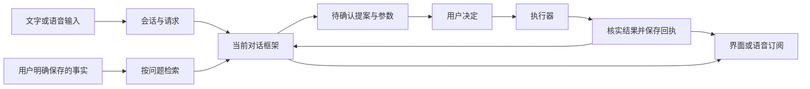

# MOSS 个人助手架构评估

2026 年 11 月 20 日。MOSS 初版采用 Agent，默认由 Pydantic AI Slim 调本机 Qwen3.5‑4B。同一个网页可以改选 DeepSeek、百炼或 Kimi。适用范围是 Windows 本机单用户。下文区分本机实测、官方源码行为和扩展建议。

## 直接点歌和原生服务离线时的处理

本轮优先处理三件事：收到明确点歌请求就给出结果并开播；用浏览器回执核实实际曲目；让本地媒体和普通问答在可选的原生服务离线时仍能使用。

1. 本地音库按稳定媒体 ID 打开文件，每个对话保存候选的顺序。Music Assistant 的本地文件源和 MPD 的队列协议为这个选择提供了参照。MOSS 保留自己的持久媒体 ID，以支持重启后接着原来的列表选曲。[Music Assistant 文件源](https://github.com/music-assistant/server/blob/9b0ab9b6264daebd71525161fc7bd96971575271/music_assistant/providers/filesystem_local/__init__.py#L1315-L1350) · [MPD 队列协议](https://mpd.readthedocs.io/en/stable/protocol.html#the-queue)
2. “现在在放什么”读取提问页面的播放器状态，“刚才听了什么”读取该聊天最近的实际播放记录。目录检索、更换候选和前端暂停均有独立含义。两标签页、历史回执和重启已分别验证。`本机跨页与重启实验`
3. 自动模式在派发原生请求前检查依赖。原生服务离线时清楚标出本机 Qwen 代答，已经派发的动作不会因为缺失最终文字而再次执行。明确想听某位歌手时直接播放第一首，只有浏览清单的请求保持暂停。`真实 Edge 点歌` · `离线时普通问答`

下一项验收是原生媒体服务恢复后的切回：在同一对话先验证本机代答，再恢复原生服务并检查下一轮的实际执行方及工具回执，核对既有播放和草稿均未重复执行。

## 哪些决定现在有依据

| 决定 | 对 MOSS 的影响 | 哪种证据会改变决定 |
| --- | --- | --- |
| 本地对话原型继续用 Pydantic AI Slim，保存一份可运行的对照实现 | 用户能交谈、批准、取消、重启续办。框架保存待批准的调用，应用拥有草稿和核实结果 | 若同一工作常常跨天、包含多个可独立重试的步骤，用相同中断测试比较 LangGraph 检查点的实现和维护成本 |
| 由工具报告动作结果，界面订阅进度 | 移植后的 550W 终端十次真实保存全部通过。点击确认后显示回执中位 52 毫秒，模型完整回复中位 1.48 秒，逐轮配对中位提前 1.43 秒。发送到预览中位 9.71 秒。`逐轮计时` | 如果一个工具的回执已回答全部问题，可按工具结束该轮。OpenAI Agents SDK 已实测能省去第二次模型请求 |
| SQLite 保管用户明确添加的原文和 ID，提供可选的独立记忆索引 | 切换检索方式可以复用现有记录。用户可以查看、删除。默认记忆不会自动收集普通聊天 | 中文同义查询须有稳定的检索收益，准确代号、无关问题、删除传播也要达标，才考虑更换默认检索方式 |

当前实现把会话保存在 MOSS 的 SQLite。云模型会收到当前问题、受长度限制的近期历史、当轮工具结果及注入的记忆。默认 SQLite 记忆库较小时会全部带入，超过 12 条或 900 UTF‑8 字节后按相关程度选择。三家云提供方各自走过真实问答、读取长期代号和生成待确认的草稿。DeepSeek 提案、改选 Kimi、服务重启后由 Kimi 接办，只发布了一个与预览一致的文件。这个结果支持将模型选择和工具操作状态分开保存。`模型与续办记录`

媒体检索也有独立的状态。索引记录本机和 NAS 中的媒体 ID，会话记录选中的版本。浏览器、模型和播放器共用这份选择。公网查找须经用户明确要求，且本机和 NAS 均健康、查空后才会发出请求。语音输入通过本机识别接入同一套对话入口。`本地媒体、共享与路由实验`

**模型路由作为可选的执行方式。** 同一终端另可选择官方 HiRoute 的固定和自动计划。12 个原生客户端样本中，6 个自动计划任务有 3 个等待分类超时，约 60 秒才转给执行模型。自动播放两次有一次缺少真实工具回执。默认保留 Pydantic 直连本机 Qwen；媒体选择与工具授权继续由 MOSS 执行器保管。更换路由器、云端模型或本地模型时，仍可用相同的文件哈希、媒体 ID 和播放回执验收。`路由逐次结果`

远程办公动作超时后的结果核对，以及家庭设备上的多用户身份识别仍待单独验证。前者影响执行器如何重试，后者影响谁能读取记忆、批准操作。

逐条调用路径、官方插件和第三方服务的区别可查阅两份源码记录。[OpenClaw 与 nanobot](./personal-assistants-a.md) · [Hermes Agent 与 Home Assistant Assist](./personal-assistants-b.md)

## 从个人助手源码追踪一条请求

| 官方项目 | 从输入到结果的路径 | 可以移用的设计 |
| --- | --- | --- |
| OpenClaw | WebChat 的消息经过网关取得运行 ID 和接收回执，随后进入会话内的代理和工具。受控重启可以重新投递续办消息。默认记忆是 Markdown 加 SQLite。第三方 Honcho 插件可把会话交给独立记忆服务 | 把收到请求和工具成功分成两个事件。把记忆提供方做成可配置项，同时明确哪些原文会发送给它。强制退出后需另查动作结果。[受理请求](https://github.com/openclaw/openclaw/blob/06afb10d3272cc9deaf38ca6a3b7b839d5935638/src/gateway/server-methods/chat-send-input-dispatch.ts#L552-L590) · [跨会话记忆插件](https://github.com/openclaw/openclaw/blob/06afb10d3272cc9deaf38ca6a3b7b839d5935638/docs/concepts/memory-honcho.md#L95-L123) |
| HKUDS/nanobot | 渠道校验发送者后把消息放入队列，代理按会话逐次处理。工具完成有独立事件。WebUI 重启若遇工具结果不明会暂停。用户档案按代理工作区共享，Dream 可以定期整理 | 同一位用户可以有多个话题，两个用户需要不同的档案范围。接入现有助手时，还要核对独立 SDK 是否启动了完整产品的后台任务。[工作区记忆](https://github.com/HKUDS/nanobot/blob/3404fe83e22b7b2cb3edae1348ed45dd9b8ad051/docs/memory.md#L42-L76) · [不确定结果的恢复](https://github.com/HKUDS/nanobot/blob/3404fe83e22b7b2cb3edae1348ed45dd9b8ad051/nanobot/webui/recovery.py#L355-L392) |
| Hermes Agent | 网关按会话分派，跟踪工具开始和完成。会话消息持久保存，订阅者按序号补读缓冲区；记忆管理器有会话初始化、提问前检索、轮次结束同步和关闭钩子 | 客户端重新连接后读取任务的权威状态。后台整理记忆时带上创建它的会话 ID，避免切换话题后写入另一个人的档案。[网关事件](https://github.com/NousResearch/hermes-agent/blob/9f47677483d1b4de4d1a88d37b3b7ca18b18b215/gateway/session_events.py#L37-L91) · [记忆提供方接口](https://github.com/NousResearch/hermes-agent/blob/9f47677483d1b4de4d1a88d37b3b7ca18b18b215/agent/memory_provider.py#L121-L175) |
| Home Assistant Assist | 设备输入可经过唤醒、识别、对话和播报。对话段可以先匹配本地意图。工具结果带调用 ID，管线再把事件交给客户端 | 文字和未来的语音共用工具执行记录。家居工具区分“已向设备发送”和“设备已达到目标状态”，各自报告能证实的结果。[语音管线](https://github.com/home-assistant/core/blob/ff5d56b825a0fb66b03d01bc297d49e206cdaba3/homeassistant/components/assist_pipeline/default_pipeline.py#L785-L831) · [工具结果事件](https://github.com/home-assistant/core/blob/ff5d56b825a0fb66b03d01bc297d49e206cdaba3/homeassistant/components/conversation/chat_log.py#L491-L564) |

Home Assistant 这里作为语音和设备控制的参照。Hermes Agent 的外部记忆提供方有的会在轮次结束后提交用户与助手的原文。MOSS 的可选 Mem0 接口仅把当前问题和用户明确保存的事实发送给本机服务。由谁决定记住什么、哪些内容被送往何处，应该可以分别检查。[Hermes 插件摄取字段](https://github.com/NousResearch/hermes-agent/blob/9f47677483d1b4de4d1a88d37b3b7ca18b18b215/plugins/memory/retaindb/__init__.py#L396-L414)

## MOSS 应该拥有的状态

1. **会话、动作和身份分别编号。** 对话 ID 确定哪些历史可以读。操作 ID 对应用户核对的参数和实际结果。框架的工具调用 ID 把模型请求与批准结果关联起来。当前原型每轮最多保存一份草稿，使用轮次 ID 命名文件。若一轮产生多个动作，每项需要单独的操作 ID 和批准记录。多用户场景还需要独立的用户身份及授权检查。
2. **审批与恢复放在执行路径上。** 原型先保存预览、调用 ID 和 Pydantic 会话，再接受确认。文件发布后从磁盘读回原文并校验，结果写入 SQLite 并通过 SSE 通知页面。若在文件发布和数据库更新之间退出，重启依据同一文件名和预览核对结果。发送消息或控制设备时，必须改为使用服务方支持的去重标识、结果查询或状态回读。无法判断是否执行时应显示“结果待核实”，自动重发可能重复产生动作。
3. **工具回执、聊天历史和个人事实分别保存。** 回执回答“执行了什么”，可查看的聊天历史回答“说过什么”，长期事实由用户管理。删除长期事实会影响以后的检索。已发送给模型的文字、用户以前的聊天和已经确认的草稿有各自的用途和保留期。若产品增加“彻底删除”，范围要覆盖这些副本以及索引的历史记录。

### 替换框架需要迁移什么

浏览器只关心操作 ID、参数预览、允许的操作、回执与版本号。网页无需认识 Pydantic 的消息类型。普通聊天原文、已完成的草稿和显式记忆可以导出。**仍在等待批准的任务和正在执行的任务**依赖原框架保存的会话数据。这是目前切换框架最昂贵的部分。现有代码把会话转换、批准和模型控制集中在 `prototype/core.py`，尚未验证框架间直接恢复对方的检查点。

迁移时可让旧运行器办完已有提案，再让新请求进入新运行器。若一定要迁移待办，需用原操作 ID、原参数和原批准状态在新系统重建提案；通过重启、重复批准和提交后中断三个案例，并从真实副作用核对是否只执行一次。向量索引可以从事实 ID 和原文重建，因此更换检索模型比转换在途的审批任务容易。

**规模也是选择条件。** 当前每次 Mem0 查询都比对该用户的完整事实列表，网页的 SSE 也会发送当前会话的完整状态。这种实现方便核对、断线重连和换检索后端，本机实验只有 24 条事实。较大档案需要按变更序号同步新增和删除，断线时补齐差异，必要时重建索引，并在目标规模实测同步时间和内存。现有网页、数据库和模型运行器仅支持单用户、单个在途请求。

## 框架选择与运行证据

| 候选 | 已经测到的能力 | 决策时仍需考虑 |
| --- | --- | --- |
| Pydantic AI Slim 2.71.0 | 真实网页确认、执行中取消、跨进程续办，核实后的回执直接显示 | 运行中的模型状态采用 SDK 表示。框架不替应用验证第三方动作是否已经发生 |
| LangGraph + SQLite | 检查点、恢复、节点重放；另用三个进程验证有命名空间的记忆存取与单条删除 | 适合多步编排。重放涉及副作用的节点时，工具必须自行去重 |
| OpenAI Agents SDK 0.25.0 | 同批交错比较，指定草稿工具直接结束后只需一次模型请求；批准后执行原调用，三次执行中取消均阻止工具写入 | 更改结束策略也会改变交互体验。需要解释、追问的轮次仍可返回给模型。[工具结束策略](https://openai.github.io/openai-agents-python/agents/#tool-use-behavior) |
| Agno 3.2.1 | 原生记忆能从一次谈话提取随机代号，按用户读取及删除；批准和 SQLite 恢复通过 | 两次取消返回受理后文件仍写出。需要把取消检查设在实际提交前。自动提取质量只有一个案例 |
| Qwen-Agent 0.0.34 | 三次真实草稿均正确。SDK 工具结果比模型最终回复中位提前 1.58 秒；工具开始前关闭生成器的一个案例没有写文件 | 两次同步工具执行中从另一线程关闭均返回 `generator already executing`，随后文件写出。持久审批和防重复执行需由应用提供 |
| HKUDS/nanobot 0.4.1 | 实测会话跨进程续聊、真实工具事件、受测等待窗口内取消；用户档案可在独立工作区重复读取 | 完整助手会随请求携带较长的运行说明。所测精简草稿首轮为 886 token。单用户工作区共享档案，不同聊天未必对应不同用户 |

独立批次的 CPU 负载、提示长度、执行路径和时间起点不同。表中依据是各项能力在其真实入口上的表现。浏览器中“批准后多久看到回执”可直接回答交互问题；它无法测出语音播放延迟，也不能单独给框架的 Python 执行效率排序。

同一聊天连续保存四份草稿时，历史消息的表示也会影响行为。一次开发批次里，前三轮的历史只有用户文字和最终回复，第四轮 Qwen 直接回答“已保存”，当轮没有调用工具、生成预览或创建文件。目前保留历史中真实的工具调用与结果，并对可识别的明确保存请求校验回执；缺少回执时要求模型重新调用，重试仍失败便向用户显示未完成。对开放式自然语言，界面上可点击、经过文件校验的回执是用户能独立核对的依据。

## 专门的记忆系统负责什么

| 方案 | 数据模型与适用问题 | MOSS 的证据 |
| --- | --- | --- |
| SQLite 原文与关键词 | 事实带稳定 ID，可列举、去重、删除。记忆库较大时使用中文双字词和英文数字词项检索 | 本机实测。22 条记录中取回早期添加的随机校验码，多次重启和删除后复查均通过 |
| Mem0 OSS | 可独立配置 LLM、嵌入模型和向量库。明确保存原文与让模型自动提取事实是两种不同操作 | 在本机独立环境配置 Mem0、Qdrant、Nomic 嵌入和 Qwen；与默认引擎共用相同的事实 ID，以便复核检索结果。[Mem0 自托管说明](https://docs.mem0.ai/open-source/overview) |
| Graphiti / Zep | Graphiti 以事件为来源，把实体关系与有效时间保存到图数据库，支持查询“当时”和“现在”的关系。Zep 对其提供托管的服务和运行管理 | 官方资料。需要维护图数据库、提取模型和嵌入模型。小模型在结构化提取中的成功率、时间冲突和删除传播尚未在 MOSS 实测。[Graphiti 与 Zep 的区别](https://github.com/getzep/graphiti#graphiti-and-zep) |
| Letta memory blocks | 有大小限制、带标签的块持续在模型上下文中，也可由多个 Agent 共享。适合需要每轮可见的少量资料 | 官方资料。若只为一项称呼或写作习惯使用该设计，当前事实表也可实现类似策略。把许多事实常驻上下文会占用本机 4096 token 的预算。[Letta 记忆块](https://docs.letta.com/v1-sdk/memory/memory-blocks) |

向量搜索返回的是相近内容，执行权限始终来自当次用户决定。让模型从普通聊天自动提取记忆，还需要验证过期事实的更正、用户拒绝保存、来源追溯，以及“忘记”能清除哪些副本。这些是与检索准确率不同的产品决定。

### 同一份中文事实上的检索

本机使用 24 条事实，包含 8 条目标记录和 16 条可能混淆的记录。8 道中文改写题、8 道精确代号题、3 道无关题各重复三次以测时间。命中数以不同题目为分母。比如目标是“坐高铁时喜欢过道座位”，问题改问“买火车票时应该替我挑哪一侧的位置？”。出现完全无关的问题时，少带入私人资料也有价值。

| 本机检索方式 | 中文改写，第一名 / 前三名命中 | 精确代号，第一名 / 前三名命中 | 无关问题仍返回条目 |
| --- | ---: | ---: | ---: |
| SQLite 中的原文，应用内关键词检索 | 0/8 · 0/8 | 8/8 · 8/8 | 0/3 |
| Mem0 + Qdrant + Nomic Embed Text v1.5 Q4_K_M | 0/8 · 2/8 | 8/8 · 8/8 | 3/3 |
| Mem0 + Qdrant + BGE-small-zh-v1.5 | 6/8 · 8/8 | 0/8 · 2/8 | 3/3 |

Nomic 使用区分文档和查询的前缀。中文改写的端到端检索中位时间为 85.2 毫秒，包含本机 HTTP、索引核对和检索；关键词检索对应的函数中位时间为 0.44 毫秒。两者测量边界不同。这份数据只覆盖指定模型、检索配置与 8 道改写题。精确代号和同义表达应分别保留测试。

在相同问题上更换为中文 BGE，8 道改写的正确事实全部进入前三。首选仍有两次出错：把“不吃香菜”问成“点菜时去掉哪种配料”，首选变成了晚饭少盐；问夜间静音，首选变成了早晨闹钟。精确代号则出现反方向的变化。实测这批大写字母数字代号经过该模型的 tokenizer 后都成了相同的未知词元组合，8 道代号查询拿到了完全相同的前三。Mem0 结果与直接余弦检索的排序在 57 次查询中完全一致。测试环境中这些 BGE 结果只使用向量分数。出处为 `alternatives/chinese-embedding/runs/20261120-115335-410062/`。[BAAI 模型说明](https://huggingface.co/BAAI/bge-small-zh-v1.5/blob/7999e1d3359715c523056ef9478215996d62a620/README.md) · [使用的 ONNX 权重](https://huggingface.co/Qdrant/bge-small-zh-v1.5/tree/46fbe35fd4374a00fee7de77dfddaeb6dd6a2c59)

因此这台机器上，**精确编号值得保留原文匹配，中文改写值得采用独立的语义检索**。两种向量配置都在三道无关题上带回了私人事实。完整的联合检索仍需要独立题目验证：什么时候读取私人资料、何时应返回空、词项与向量意见不一致时如何排序。当前数据不足以确定通用分数阈值，也不足以宣称已经解决这三件事。

**显式记忆与自动提取的区别会影响实际部署。** Mem0 的显式写入、重启读取、两个用户互相隔离、按 ID 删除及换文后重新索引均通过。删除后已经无法检索，但 Mem0 的历史 SQLite 仍保留增加和删除时的原文。开启自动提取后，输入“我每周三上午去游泳”实际向 Qwen 提交了 8221 token，超过本原型 4096 token 的上限，服务返回 HTTP 400。这一结果只适用于当前默认提取模板和上下文设置。原始记录位于 `alternatives/mem0/runs/20261120-113941-589338/`。

**切换后端走过了真实网页和 Qwen。** 独立 SQLite 库中写入随机订座代号和三条干扰事实；切换至 Mem0 后，四条事实的原始 ID 一致，模型从检索结果读出了正确代号。在索引离线时删除该条，SQLite 删除成功，页面可以看到同步错误。恢复连接、重启应用并开新对话后，实际送给模型的 ID 中已无该条，Qwen 回答“未知”。这轮经过四个网页服务进程。`网页端迁移与删除记录`

同一客户端改连使用 BGE 的 Mem0 实例，也通过了上述网页迁移、离线删除和恢复检索，两个模型使用独立索引。客户端提交的原文与事实 ID 无需转换。`BGE 网页验收` · `浏览器逐次计时`

### 进入产品前，哪些情况还缺证据

| 用户场景 | 目前已经证实 | 会改变架构选择的验收条件 |
| --- | --- | --- |
| 保存草稿后立即知道结果 | 本地文件能按操作 ID 核验，网页可从回执直接打开 | 外部服务也能区分未提交、已提交、结果待核实；重复确认或进程退出不会重复发送 |
| 助手记得我的习惯，也能学会更正 | 显式写入、跨会话召回和删除已实测，专用后端的中文改写成绩随配置而变 | 使用未用于调试的中文问题，有干扰事实、纠错、否定和过期资料；同时统计找错、找不到、误带私人资料三类错误 |
| 两位家庭成员共用设备 | 记忆服务按作用域隔离。原型网页只服务一名本机用户 | 从输入设备到工具执行都能确认操作者；不同身份不可读取、删除或批准对方的事项 |
| 加入语音或多个客户端 | 浏览器可断线后重取状态。独立端点已用本机 SenseVoice 识别固定语句，并以音乐、静音作对照 | 界面显示、语音开始播放分别计时；断线重连时不重复播报，已在设备上执行的动作能核对 |
